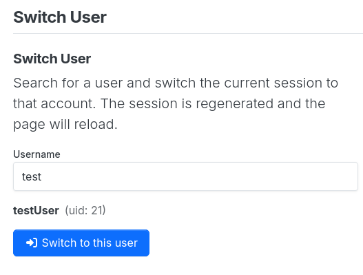

# NodeBB Plugin: Switch User



A small NodeBB plugin that lets an administrator switch the current admin session to another user account — the forum equivalent of `su` in a shell.

## Description

Sometimes you need to see the forum exactly as a specific user sees it, or act on their behalf. This plugin adds a **Switch User** page to the admin control panel where you can search for a user by username and switch your session to that account in one click.

- The session is regenerated on switch, so the change is clean and safe.
- The page reloads after switching, dropping you into the target account.
- Only **administrators** can use this feature.

## How it works

1. Navigate to **Admin → Plugins → Switch User**.
2. Type a username into the search box. The first matching user is shown with their avatar and uid.
3. Click **Switch to this user**.
4. The page reloads and you are now logged in as the target user.

To switch back, simply log out and log in again as your original account.

## Installation

From your NodeBB root directory:

```bash
./nodebb plugin install nodebb-plugin-su
```

Then restart NodeBB.

## License

[MIT](LICENSE)
